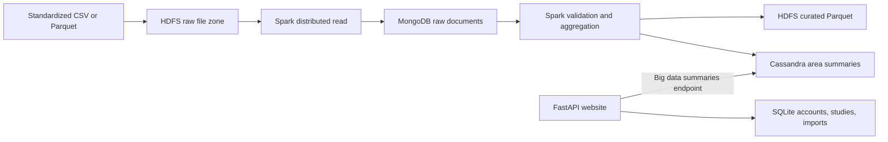

# SpotWise

SpotWise is a full-stack big data analysis project for researching where to open a local business. A responsive dark-mode website calls a FastAPI backend, reads prepared Kaggle analysis, stores website studies and account-owned imports in SQLite, and calculates transparent break-even and location-readiness scenarios. An optional batch pipeline uses Apache Spark for distributed cleanup and aggregation, HDFS for raw and curated Parquet zones, MongoDB as a flexible raw-document landing/readback layer, and Apache Cassandra to serve area-level summaries.

## What it does

- Compares Mumbai residential rental listings by inferred locality, analyzes India-wide job postings, and summarizes city-level rail schedule coverage.
- Filters uploaded local records by city, neighborhood, and—when coordinates are present—straight-line radius.
- Imports CSV, Excel (.xlsx), JSON, JSON Lines, Parquet, and static GTFS ZIP data for footfall, competitors, traffic, parking, transit, workforce, wages, cost of living, and commercial rent.
- Summarizes uploaded records, including average, median, totals, hourly peak, and nearest geocoded transit point.
- Saves, edits, lists, compares, and deletes location studies in a persistent SQLite database.
- Provides account sign-up/sign-in, private saved studies and imports, and a guided explanation of the workflow and Big Data stack.
- Scores factors only when both an uploaded signal and a matching user target exist. A composite readiness score requires at least three scored factors.
- Calculates a user-entered monthly break-even scenario and exports a JSON research snapshot.
- Serves interactive API documentation at `/docs`.

## Interface and frontend design

SpotWise uses a dark, low-glare workspace with a lime accent, muted green surfaces, and Plus Jakarta Sans / Space Grotesk typography. A perspective-based orbital hero, layered cards, gentle hover depth, and restrained glow add 3D character while keeping the analysis controls legible. The layout groups the work into a clear path: select a market and business, review local context, check workforce and transport signals, model break-even, then save or compare studies. Cards, data-source badges, freshness notes, and empty states help distinguish observed data from user assumptions. The interface adapts to desktop and mobile widths, supports an optional light theme, and includes visible keyboard focus and reduced-motion support.

The frontend is plain HTML, CSS, and JavaScript served by FastAPI; it has no Node build step. The regular website backend uses FastAPI, SQLAlchemy, SQLite, scikit-learn/joblib, PyArrow, and DuckDB for bounded cloud queries on Overture GeoParquet. The optional batch stack is Spark 3.5.7 (PySpark) + HDFS 3.5.0 + MongoDB 8.0 + Cassandra 5.0.9, with Apache Spark Cassandra Connector 3.5.1 and MongoDB Spark Connector 10.7.0. It is separate from the lightweight default website, and does not require its large containers for normal use. `requirements.txt` is for the regular web app; the Spark runtime and connector are provided by the optional Docker services.

## Big data pipeline: Spark, HDFS, MongoDB, and Cassandra

The optional stack has a connected batch flow; these tools are not merely listed as technologies. Standardized signal files are copied into HDFS as the durable raw-file zone. Spark reads each file and writes source rows into a run-specific MongoDB collection as flexible raw documents, then reads those documents back through the [MongoDB Spark Connector](https://www.mongodb.com/docs/spark-connector/v10.x/getting-started/). Spark validates and cleans rows, removes exact duplicates, writes city/category-partitioned Parquet back to HDFS, and aggregates by city, area, signal category, metric, and unit into Cassandra. The connector supports Spark 3.5 with a Scala 2.12 artifact and MongoDB 4.2 or later. Spark workers distribute tasks in [standalone mode](https://spark.apache.org/docs/3.5.7/spark-standalone.html); the [Cassandra connector](https://github.com/apache/cassandra-spark-connector) writes summary DataFrames. Read about [HDFS](https://hadoop.apache.org/docs/current3/hadoop-project-dist/hadoop-hdfs/HdfsUserGuide.html), [MongoDB](https://www.mongodb.com/docs/), and [Cassandra](https://cassandra.apache.org/doc/stable/cassandra/getting-started/) in their official documentation.



The large services are opt-in because they use substantially more memory and disk than this class-project website. Install Docker Desktop/Engine with Compose v2, then supply a CSV or Parquet file with at least `city,value`; optional columns are `area,category,metric,unit,name,detail,observed_at,latitude,longitude`. If the file lacks a category or metric column, set them as arguments. Example:

```bash
docker compose up -d spotwise
./scripts/run_bigdata_pipeline.sh data/raw/my_footfall.csv footfall pedestrians_per_hour
```

The script starts optional services, stages the file to HDFS, initializes Cassandra, and submits Spark with both connectors. MongoDB retains a run-specific raw document collection; HDFS keeps raw and curated Parquet; Cassandra stores aggregates. The website's optional `GET /api/v1/bigdata/summaries?city=Bengaluru&category=footfall` endpoint reads those area summaries from Cassandra. Docker Compose configures the website container to connect to the `cassandra` service. If running FastAPI directly on your computer, start the profile services and launch it with `SPOTWISE_CASSANDRA_CONTACT_POINTS=127.0.0.1 python3 run.py`. Use `docker compose --profile bigdata up -d` to start manually; Spark UI is at [http://localhost:8088](http://localhost:8088), HDFS NameNode UI at [http://localhost:9870](http://localhost:9870), Spark worker UI at [http://localhost:8081](http://localhost:8081), MongoDB is reachable from the other Big Data services on the private Compose network only (port 27017 is not published to the host). Query Cassandra with `docker compose --profile bigdata exec cassandra cqlsh -e 'SELECT * FROM spotwise.area_signal_summary;'`; inspect Mongo collections with `docker compose --profile bigdata exec mongodb mongosh spotwise --eval 'show collections'`. Stop optional services with `docker compose --profile bigdata down`; add `-v` only if you intentionally want to delete the HDFS, MongoDB, and Cassandra volumes.

### Where each big-data tool is used

| Tool | SpotWise workflow | What it does not do |
| --- | --- | --- |
| HDFS | The pipeline stages each input under `/spotwise/raw/<run-id>` and writes cleaned, city/category-partitioned Parquet under `/spotwise/curated/<run-id>`. | HDFS is not the default website database and does not host the bundled Kaggle aggregates. |
| Apache Spark | `bigdata/spark_etl.py` reads staged files, moves raw rows through MongoDB, standardizes city/area labels, rejects invalid rows, writes curated Parquet, and computes area summaries. | Spark runs only when the optional batch command is executed, not during each dashboard request. |
| MongoDB | Each batch run stores source records in a separate `spotwise.raw_<run-id>` collection, then Spark reads that collection before cleanup. | This is batch staging, not the website user-import database. The local Compose service has no authentication and is not published to host ports; keep the Docker network on a trusted development machine. |
| Apache Cassandra | Spark writes summary rows to `spotwise.area_signal_summary`; `GET /api/v1/bigdata/summaries` reads them when Cassandra is configured. | Cassandra does not currently replace SQLite for saved studies or interactive imports. |
| SQLite | The normal FastAPI workflow stores imported observations, source batches, and saved studies here. | SQLite is suitable for this class-project setup, not a distributed high-write store. |

The optional pipeline now canonicalizes common city names and aliases (for example, `BANGALORE`, `Bangalore`, and `Bengaluru` all become `Bengaluru`), collapses repeated whitespace, maps blank areas to `Citywide`, and excludes null, NaN, or infinite values. Malformed numeric strings become null via Spark's [`try_cast`](https://spark.apache.org/docs/3.5.7/sql-ref-ansi-compliance.html); invalid timestamps become null via [`try_to_timestamp`](https://spark.apache.org/docs/3.5.7/api/python/reference/pyspark.sql/api/pyspark.sql.functions.try_to_timestamp.html) rather than dropping an otherwise usable observation. It reports input, invalid, exact-duplicate, and output row counts. Invalid coordinates become null. The approximate median uses Spark's `percentile_approx` with accuracy parameter 10,000, so it is an approximation rather than an exact percentile. A repeated run updates Cassandra rows with matching `(city, category, metric, area, unit)` keys; its separate HDFS output remains under that run's ID.

### Worked example and verification results

This miniature CSV illustrates the cleanup behavior; the numeric output below is calculated from these six example rows, not a claim that the distributed cluster was run:

```csv
city,area,category,metric,value,unit
BANGALORE,Indiranagar,footfall,visitors_per_hour,120,people/hour
Bengaluru,Indiranagar,footfall,visitors_per_hour,180,people/hour
Bengaluru,Indiranagar,footfall,visitors_per_hour,240,people/hour
Bengaluru,Indiranagar,footfall,visitors_per_hour,180,people/hour
Bengaluru,,footfall,visitors_per_hour,90,people/hour
Bengaluru,Indiranagar,footfall,visitors_per_hour,not-a-number,people/hour
```

After city normalization, the exact duplicate, and invalid-value filtering, Spark would report `input=6`, `invalid=1`, `exact_duplicates=1`, `output=4`. Cassandra would receive two groups: `Bengaluru / Indiranagar` with 3 records, average 180, median 180, total 540, min 120, max 240; and `Bengaluru / Citywide` with 1 record and value 90. The three distinct Indiranagar values make the example median unambiguous. The city aliases ensure the area summaries use the same city key that the dashboard and API expect.

The regular website workflow is exercised using disposable test data. As of this README update, `python3 -m unittest discover -s tests -v` passes **6 tests**, including account signup/login, ownership isolation, and anonymous write protection. Coverage includes: previewing a CSV with one valid row, one duplicate, and one invalid value (expected preview counts: `clean_rows=1`, `duplicates_removed=1`, `skipped_invalid_rows=1`); importing CSV, XLSX, JSON, JSONL, Parquet, and static GTFS; filtering competitors by selected business type; rejecting malformed uploads and incomplete coordinates; salary and category model endpoints; and creating, updating, comparing, and deleting saved studies. These are backend/API regression results, not load tests or a Spark cluster integration run.

**Environment limitation:** the current workspace does not have Docker installed, so the Spark/HDFS/MongoDB/Cassandra containers and connectors cannot be executed or certified here. Their Compose wiring, Spark script, Cassandra schema, and API integration are present in the repository, but the example above is a hand-calculated expected result. To verify the distributed path on a machine with Docker, run the command in the next example section against that CSV and then query Cassandra and the API endpoint.

To run the exact six-row example, save the CSV above as `/tmp/spotwise-demo.csv`, then run:

```bash
./scripts/run_bigdata_pipeline.sh /tmp/spotwise-demo.csv footfall visitors_per_hour
docker compose --profile bigdata exec cassandra cqlsh -e \
  "SELECT city,area,metric,unit,record_count,average_value,median_value,total_value FROM spotwise.area_signal_summary WHERE city='Bengaluru' AND category='footfall';"
curl 'http://127.0.0.1:8000/api/v1/bigdata/summaries?city=Bengaluru&category=footfall'
```

This is a single-node teaching setup with one HDFS DataNode and one Spark worker, not a fault-tolerant production cluster. HDFS replication is 1. Interactive account imports and studies still use SQLite; the optional Spark/MongoDB/HDFS/Cassandra pipeline is a separate shared batch demonstration. Do not pass private account uploads into the shared pipeline without adding tenant-aware controls. No user API key is needed.

### What the Spark job cleans and outputs

The Spark job canonicalizes common city aliases, standardizes area/category/metric/unit labels, fills absent areas as `Citywide`, parses numeric values and timestamps, excludes rows with missing city/category/metric or null/NaN/infinite values, and removes exact duplicates. Invalid coordinates and timestamps become null while the rest of the row remains usable. It writes cleaned observations as Parquet partitioned by city/category under `/spotwise/curated/<run-id>` and upserts group summaries into Cassandra table `spotwise.area_signal_summary`. Summary values include record count, average, approximate median, total, minimum, maximum, and refresh time. Coordinate values are kept when valid; this teaching ETL does not claim to calculate travel times, infer pedestrian counts, or guarantee that input units/source quality are valid. Inspect source dates, units, categories, licenses, and row counts before using results for a decision.

### Dataset inventory: sources actually used

These are the external source datasets used to build the current analysis or trained models. The links go to the original dataset/provider pages; rows stored in ignored local files/database are not automatically included in a Git clone.

| Dataset used | Link | How SpotWise uses it | Main limitation |
| --- | --- | --- | --- |
| Property Rental Listings Dataset (23,405 records) | [Kaggle dataset](https://www.kaggle.com/datasets/harshalhonde/property-rental-listings-dataset) | Prepared Mumbai neighborhood residential asking-rent summaries; includes the locality chart and median context. | 2023 snapshot; scraped residential listings, not current commercial lease offers. |
| Indian Job Market Dataset 2025–2026 (97,929 postings) | [Kaggle dataset](https://www.kaggle.com/datasets/shivamshrivastava21/indian-job-market-dataset-2025-2026) | City and role-group job posting summaries and the trained salary range benchmark (33,203 disclosed INR salary rows after cleaning). | Online postings are not the available workforce; salary data is disclosed for only a subset; CC BY-NC-SA 4.0. |
| Indian Railways Time Table for Trains (69,006 schedule rows) | [Kaggle dataset](https://www.kaggle.com/datasets/harsh16/indian-railways-time-table-for-trains-available) | Historical city-level station/service schedule context. | 2015 snapshot; city matches inferred from station names; it does not represent current local metro service. |
| Overture Maps Places release `2026-10-21.0` (about 77,958 Bengaluru records used for classifier training) | [Places data guide](https://docs.overturemaps.org/guides/places/) · [Cloud download/query guide](https://docs.overturemaps.org/guides/using-overture/) · [Attribution and licensing](https://docs.overturemaps.org/guides/attribution/) | Trains the name-to-category helper. A separate local import has 2,136 Bengaluru restaurant records at existence-confidence ≥0.85, used as a weighted listing-density proxy. | Monthly global map data with upstream-source variation and duplicate/incomplete place records. Existence confidence is not calibrated demand or footfall. Follow Overture attribution terms. |
| Namma Metro GTFS feed version `20260817` | [Feed and source notes](https://metroroute.net/data-sources) | Local import contains 170 geocoded station/stop observations for transit access context. | Community-transcribed schedule; intermediate stop times are estimated. It is not passenger ridership or real-time service. |

SpotWise also documents **candidate** sources in the Data Coverage and Recommended Dataset Expansion sections below. A source candidate or link is not counted as a dataset used until its records are actually obtained, cleaned, scoped to a city, and imported. The Spark batch workflow accepts user-provided standardized CSV/Parquet signal files; it does not automatically download Kaggle datasets or include raw licensed files in Git.

## Run the full website and backend

Requires Python 3.10 or later.

```bash
python3 -m venv .venv
source .venv/bin/activate
python -m pip install -r requirements.txt
cp .env.example .env
python3 run.py
```

Open [http://127.0.0.1:8000](http://127.0.0.1:8000). The API is at `/api/v1`; interactive API docs are at [http://127.0.0.1:8000/docs](http://127.0.0.1:8000/docs). The default database file is `data/spotwise.db` and is ignored by Git. The website and API run on the same origin, so no browser API key or CORS setup is needed.

Run the backend workflow regression checks with `python3 -m unittest discover -s tests -v`. They use a disposable SQLite database and exercise imports, cleaning, city scoping, transit feeds, salary/category models, scoring, studies, and API validation.

Or run the app in a container with `docker compose up --build`; the `data` directory is mounted so the SQLite database persists across container restarts.

For a different database, set `DATABASE_URL`. SQLite is the default for a single-user class project; SQLAlchemy can connect to PostgreSQL when its database driver is installed and configured.

## Backend API

| Endpoint | Purpose |
| --- | --- |
| `GET /api/v1/health` | Backend, database, and analysis-data status |
| `GET /api/v1/markets` | Available markets and business types |
| `GET /api/v1/areas?city=Mumbai` | Rental neighborhoods plus uploaded areas |
| `GET /api/v1/dashboard?city=Mumbai&area=Powai` | Kaggle aggregates, market context, and matching local signals |
| `GET /api/v1/signals?city=Mumbai&area=Powai&radius_km=1&latitude=19.1&longitude=72.8` | Local imported signal aggregates and radius filtering |
| `GET /api/v1/data-sources` | Kaggle sources and locally imported batches |
| `GET /api/v1/bigdata/summaries?city=Bengaluru&category=footfall` | Read Spark-produced area summaries from Cassandra when configured |
| `GET /api/v1/transport-sources?city=Bengaluru` | Current transit source links for a selected city |
| `POST /api/v1/datasets/preview` | Scan and preview CSV, XLSX, JSON, JSONL/NDJSON, Parquet, or static GTFS ZIP data |
| `POST /api/v1/datasets/import` | Clean, normalize, and persist a local signal dataset |
| `POST /api/v1/workforce/salary-estimate` | Estimate a role salary from the trained posting benchmark |
| `POST /api/v1/business/classify` | Suggest Overture business taxonomy categories from listing names |
| `DELETE /api/v1/data-sources/{id}` | Remove an uploaded batch and its imported records |
| `GET/POST /api/v1/studies` | List or save a location study |
| `GET/PUT/DELETE /api/v1/studies/{id}` | Retrieve, update assumptions, or remove a study |
| `POST /api/v1/studies/compare` | Compare two to four saved studies |
| `GET /api/v1/coverage?city=Mumbai` | Show source leads and city-specific imported coverage |

The backend uses FastAPI with SQLAlchemy and SQLite by default. FastAPI documents SQLite as a simple local option and SQLAlchemy supports switching to other database engines; see the [FastAPI SQL database guide](https://fastapi.tiangolo.com/tutorial/sql-databases/) and [SQLAlchemy ORM quick start](https://docs.sqlalchemy.org/en/21/orm/quickstart.html).

## Import your own local datasets

Use the Data & methods section in the website, or send a multipart request to `POST /api/v1/datasets/import`. Select a signal category and upload CSV, Excel (.xlsx, first worksheet), JSON (array of objects or a `data`/`records`/`items` array), JSON Lines/NDJSON, Parquet, or a static GTFS ZIP. The website scans the file before import and previews sample rows, usable/invalid/duplicate counts, coordinate coverage, and common input issues. Current limits are 50 MB compressed and 100,000 output rows; expanded GTFS ZIP content is limited to 512 MB. The backend rechecks every row and stores normalized observations in SQLite; it does not retain the original file.

For a GTFS ZIP, set the signal type to **Transit stops / stations**, choose the feed's city, then scan and import. The parser requires `stops.txt`, `routes.txt`, `trips.txt`, and `stop_times.txt`; it does not accept GTFS-Realtime protobuf files. It counts distinct routes serving each geocoded stop and checks `calendar.txt` / `calendar_dates.txt` for service on at least one of the next seven days. The nearest-stop feature and optional route-stop target then use these imported coordinates and route counts. Review the source feed's date range and license first. GTFS schedules show scheduled service, not passenger counts, road traffic, delays, or business success.

The neighborhood picker only suggests areas backed by data for the currently selected city. The included preset locality list is Mumbai-only; other cities show no preset areas until local signals or saved study areas exist. You can still type a neighborhood manually, but area-specific metrics remain empty until matching local evidence is imported.

Download the [CSV template](data/import-template.csv). Required columns are `city` and numeric `value`. Optional columns are:

```text
area, observed_at, metric, unit, name, category_label, latitude, longitude
```

`observed_at` should be an ISO date or datetime. Coordinates must be WGS84 latitude/longitude decimals. Coordinates enable straight-line radius filtering and nearest-stop calculations; they do not represent walking distance or travel time.

The upload scan checks UTF-8 CSVs (comma, semicolon, tab, or pipe separators), XLSX, JSON, JSONL/NDJSON, Parquet, and static GTFS ZIP. It maps common header aliases, validates numeric values, date/time strings, and coordinate pairs, and reports exact duplicate records. It does not silently remove unusual high/low values: review the reported range and source units before importing. Exact-row de-duplication is optional because repeated measurements can be valid when the timestamp or location differs.

Recommended metric labels:

| Import category | Example metric | Example unit |
| --- | --- | --- |
| Footfall | `daily_visitors` | `people/day` |
| Competition | `competitor_count` | `business` (one row per business) |
| Traffic | `average_speed_kmh` or `vehicles_per_hour` | `km/h` or `vehicles/hour` |
| Parking | `available_spaces` | `spaces` |
| Transit | `transit_stop` | `stop` (add coordinates) |
| Worker availability | `available_workers` | `workers` |
| Salary | `monthly_salary` | `INR/month` |
| Cost of living | `monthly_cost` | `INR/month` |
| Commercial rent | `commercial_rent` | `INR/month` |

Label rows consistently. Salary and cost targets must use the same units as their uploaded data. Each imported batch displays its source/notes and removal control in the website.

## Readiness score and business scenario

The readiness score is a transparent comparison heuristic, not a probability of success. A factor is scored only when both its uploaded records and a corresponding target are present. By default, observed factors have equal weight; scores are omitted until at least three factors can be evaluated.

Supported target assumptions include monthly rent vs budget, minimum footfall, maximum competitor count, maximum distance to transit, minimum GTFS route-stop connections in the study radius, minimum road speed, minimum parking spaces, required workers, maximum monthly wage, and maximum local cost. Overture Places observations with the `confidence_weighted_poi` metric contribute their source confidence to the competitor-density proxy; other uploaded competitor datasets are counted as records. For traffic, SpotWise only scores a speed metric; raw vehicle counts are shown as context because higher volume can mean either customer access or congestion.

This is a transparent decision-support score, not a trained prediction of business success. No verified open dataset with business opening/closure, revenue, and location features was found to provide valid outcome labels. Overture provides place/category/existence-confidence labels, not profit outcomes; using those records as profit-training labels would be misleading. The separate salary estimator is trained on disclosed job-posting ranges and is not a worker-supply or business-profit model.

The break-even calculator uses:

```text
monthly fixed costs = rent + staff count × monthly pay per staff + other fixed costs
monthly sales = average customer spend × expected customers per day × 30
estimated operating surplus = monthly sales × gross margin − monthly fixed costs
break-even customers per day = monthly fixed costs ÷ (average spend × gross margin × 30)
```

It excludes taxes, financing, owner pay, setup costs, seasonality, and other variable costs. Customer volume, rent, pay, margin, and most operational inputs must be provided by the user.

## Kaggle analysis sources

| Data | Kaggle source | Rows | License and scope |
| --- | --- | --- | --- |
| Mumbai rental listings | [Property Rental Listings Dataset](https://www.kaggle.com/datasets/harshalhonde/property-rental-listings-dataset) | 23,405 | CC BY 4.0. Attribution: Harshal H. Residential listings scraped from Magicbricks; snapshot last updated August 2023. Not commercial lease data. |
| India job postings | [Indian Job Market Dataset 2025](https://www.kaggle.com/datasets/shivamshrivastava21/indian-job-market-dataset-2025-2026) | 97,929 | CC BY-NC-SA 4.0. Non-commercial and share-alike terms apply to adapted data; 2025 snapshot. Postings are not a count of available workers. |
| Indian rail timetable | [Indian Railways Time Table for Trains Available](https://www.kaggle.com/datasets/harsh16/indian-railways-time-table-for-trains-available) | 69,006 | Kaggle labels the database as Open Database / Database Contents. Historical 2015 timetable; city matches are inferred from station names. Verify source license text for reuse. |

Prepared aggregates are included in `data/analysis.json`; raw source archives are excluded from Git. Rebuild the analysis with the standard-library pipeline:

```bash
python3 -m pip install kaggle
kaggle datasets download -d shivamshrivastava21/indian-job-market-dataset-2025-2026 -p data/raw/jobs --unzip
kaggle datasets download -d harshalhonde/property-rental-listings-dataset -p data/raw/rentals --unzip
kaggle datasets download -d harsh16/indian-railways-time-table-for-trains-available -p data/raw/rail --unzip
python3 scripts/build_analysis.py \
  --jobs data/raw/jobs/indian-job-market-dataset-2025.xlsx \
  --rentals data/raw/rentals/Mumbai_property_details.csv \
  --rail data/raw/rail/isl_wise_train_detail_03082015_v1.csv \
  --out data/analysis.json
```

## Trained salary benchmark

The repository includes a fitted scikit-learn Ridge pipeline at `models/salary_estimator.joblib`, trained from the included Kaggle job posting source. It predicts an annual salary midpoint from job title, skills, broad market, role group, and experience; the website exposes it as a monthly estimate and empirical holdout range. The source has 97,929 rows, of which 33,203 disclosed INR salary rows passed cleaning. Evaluation uses an 80/20 holdout grouped by exact normalized job title: MAE ₹274,469/year, median absolute error ₹102,409/year, R² 0.523, and median absolute percentage error 23.55%. See `models/salary_estimator_metrics.json` for split details and limitations. This is a posting benchmark, not available-worker counts or a local wage survey.

The source is CC BY-NC-SA 4.0. Non-commercial and share-alike terms apply to adapted data and the derived model. Keep this project academic/non-commercial unless you confirm rights for your intended use. Raw job data is excluded from Git. To retrain after obtaining the source file:

```bash
python3 scripts/train_salary_model.py --jobs data/raw/jobs/indian-job-market-dataset-2025.xlsx
```

The script writes a fitted model and its evaluation report under `models/`.

## Trained business-category model

SpotWise also includes `models/place_category_classifier.joblib`, trained from Overture Places labels. It suggests a taxonomy category from a business listing's name to help review and clean competitor data. Training used 77,958 Bengaluru listings from release `2026-10-21.0`; 75,286 named/category-labeled rows were eligible, and the grouped holdout contained 18,536 rows across 158 categories. Holdout top-1 accuracy was 48.0%, top-3 accuracy 64.2%, and macro F1 0.368. Identical normalized names were kept in one split to reduce leakage. This is a rough suggestion tool, trained on Bengaluru only; the API returns a scope warning for other cities and must not silently overwrite user labels.

Example request to `/api/v1/business/classify`:

```json
{"city":"Bengaluru","names":["Cafe Coffee Day","Apollo Pharmacy"]}
```

The API returns up to three category suggestions and uncalibrated model scores for each name. A low holdout score means suggestions need human review. The model is not for business success, demand, or revenue prediction.

### Measured model performance and accuracy limits

These are held-out evaluation results from the checked-in model reports, not guarantees for future neighborhoods or business outcomes:

| Model | Evaluation result | How to interpret it |
| --- | --- | --- |
| Salary benchmark | Grouped holdout median absolute error ₹102,409/year; MAE ₹274,469/year; R² 0.523; median absolute percentage error 23.55%; empirical 90% interval coverage 89.98%. | Typical estimates can be far from a real offer. Use the wide range as a planning signal; validate against current local hiring quotes. |
| Place-name classifier | Grouped holdout top-1 accuracy 48.0%; top-3 accuracy 64.2%; macro F1 0.368 over 158 categories. | It is a review aid for listing cleanup. The modest accuracy and Bengaluru-only training mean a human should confirm every material classification. |
| Location readiness | No measured predictive accuracy. | This is an equal-weight, user-target comparison heuristic. No verified open business profit/survival labels were available to train and evaluate a success model. |

The project does not currently have a valid, representative holdout set for customer footfall, commercial rent, parking occupancy, traffic speed, worker availability, revenue, or business survival. Therefore it cannot claim high predictive accuracy for those outcomes. Improving reliability requires recent, licensed, geocoded records plus outcome labels and a time- or geography-held-out evaluation; adding more unrelated rows would not make the estimate more accurate.

Training and evaluating the classifier uses the larger, multi-category Overture query:

```bash
python scripts/prepare_overture_places.py \
  --city Bengaluru \
  --minimum-confidence 0.70 \
  --max-rows 95000 \
  --output data/processed/overture_bengaluru_all_2026-10-21.0.csv
python scripts/train_place_category_model.py \
  --places data/processed/overture_bengaluru_all_2026-10-21.0.csv
```

The fitted artifact and evaluation report are written to `models/`. The training release contains about 78,000 Bengaluru records and many taxonomy categories; see `models/place_category_classifier_metrics.json` for the exact holdout results. Name-only labels are ambiguous and local naming varies, so suggestions can be wrong. The classifier does not estimate business demand, revenue, profit, or success. Overture is an open data aggregation with upstream sources and attribution obligations; review the [attribution and licensing guidance](https://docs.overturemaps.org/guides/attribution/) before redistribution or commercial use.

## Scope and deployment notes

The static Kaggle sources do not contain live footfall, current competitor locations, traffic, parking occupancy, current metro/bus access, or neighborhood-level workforce availability. Import appropriately licensed datasets to analyze those dimensions; external maps/mobility API credentials are not required for local operation. No API key is bundled.

## Recommended dataset expansion

The website's **Data coverage** panel is a source map, not a claim that every source has already been downloaded. Its green **Source found** tag means a credible dataset or provider has been identified. **Local data** appears only when SpotWise has imported observations for the selected city; imported data for Bengaluru, for example, cannot mark Mumbai covered. Cards also report whether imported records have an area label. Select a source link in a card to review its original terms and access requirements.

The following official and maintained sources improve on city-mismatched sample data. Availability varies by city. Overture Places is now queried and imported for Bengaluru; the other source rows are documented leads until their records are downloaded, cleaned, geocoded, dated, and imported.

| Signal | Dataset / provider | What it can support | Limitation |
| --- | --- | --- | --- |
| Business competition and amenities | [Overture Maps Places](https://docs.overturemaps.org/guides/places/) | Geocoded business and amenity place listings with taxonomy and monthly global releases; public S3/Azure extracts can be queried for an area of interest. | Large, broad source. Known duplicates, junk records, and incomplete attributes; confidence only estimates whether a place exists. Filter category, status, confidence, deduplicate, validate India coverage, then import. It is not a complete live competitor census. |
| Residential demand context | [GHSL GHS-POP R2023A](https://human-settlement.emergency.copernicus.eu/ghs_pop2023.php) · [AWS Open Data listing](https://registry.opendata.aws/ghs-pop/) | Modelled population grids at 100 m / 1 km; 2025–2030 include short-term projections, CC BY 4.0. | Population is residential and modelled/disaggregated, not daytime visitors, customer demand, or measured footfall. GHSL is documented as an additional source; its raster is not yet bundled or ingested by SpotWise. |
| Traffic, transit, and parking | [IUDX city catalogue](https://catalogue.iudx.org.in/) · [IUDX cities](https://iudx.org.in/cities/) | Discover participating Smart City feeds, including traffic, bus/transit, and smart parking resources. | Per-city sharing differs. Resource data may need an access token, approval, or city-provider permission. A catalogue entry is not proof of an accessible/current feed. |
| Traffic and municipal datasets | [India Smart Cities Open Data](https://smartcities.data.gov.in/) | Discover datasets published by participating municipal Smart City portals. | Catalog and resource completeness varies; inspect the actual download, geography, date, and license before relying on it. |
| Transit access | [Delhi Open Transit Data](https://otd.delhi.gov.in/documentation/) | Delhi bus GTFS stops, routes, trips, and schedules; a usable example of a city-specific source. | Delhi only. Published stop times are described as rough estimates; real-time feeds require authorization. Obtain another city's official GTFS feed separately. |
| Transit footfall | [Delhi Transport Stack data services](https://delhi.transportstack.in/data-services) | Potential station-level hourly passenger counts and transit context in Delhi. | Provider access/approval and product scope apply. Station entries are not pedestrian footfall for every nearby street or neighborhood. |
| Consumer cost context | [MoSPI Consumer Price Index](https://cpi.mospi.gov.in/) · [eSankhyiki CPI catalogue](https://esankhyiki.mospi.gov.in/catalogue-main/catalogue?product=CPI) | Official monthly price and index series. CPI collection covers selected urban markets and towns; useful as a broad inflation/context feature. | Not shop rent, neighborhood cost of living, or a business expense schedule. Match geography, series, base, units, and month before importing. |
| Population and household profile | [Census of India API](https://censusindia.gov.in/census.website/en/data/api/about) · [Census 2011 Towns Directory](https://data.gov.in/catalog/complete-towns-directory-indiastatedistrictsub-district-level-census-2011) | Public aggregated population and housing context at available administrative geographies. | Census tables are historical (2011) and administrative areas do not equal modern neighborhoods. Use as dated context, not current footfall. |
| Household expenditure | [MoSPI HCES 2023–24](https://www.mospi.gov.in/sites/default/files/publication_reports/HCES%20FactSheet%202023-24.pdf) | Household consumption/expenditure context; official microdata access and terms are described by MoSPI. | Broad geography and household context; not business operating costs. Microdata may require registration and an access agreement. |
| Workforce | [MoSPI microdata portal](https://microdata.gov.in/) | Official labor-force survey data can contextualize employment at the geography made available. | Not a neighborhood count of workers ready to take a particular job. Check registration, permitted use, survey period, and geography. |
| Retail commercial rent | [IIM Bangalore Commercial Real Estate Research Initiative](https://www.iimb.ac.in/reri/) | Commercial real-estate research and market indicators may provide wider office-market context. | No verified open, current, neighborhood-level shop/cafe lease dataset found. Residential Mumbai listings and office indices are not retail rent evidence. Collect current local leases or use a licensed listing provider. |
| Street footfall / live parking | [Local authority or licensed mobility provider](https://delhi.transportstack.in/data-services) | Hourly pedestrian counts or parking occupancy when a city/provider actually exposes these measures. | No verified free, current, all-city neighborhood feed found. Use approved local counts or a licensed feed; never infer footfall from a language model or POI count. |

These source links are included in the coverage endpoint and rendered as clickable references in the site. The project does **not** bundle raw Overture, GHSL, CPI, Census, IUDX, or Delhi GTFS source extracts. The current local database has 2,136 Bengaluru Overture restaurant observations (release `2026-10-21.0`, minimum existence confidence 0.85) and 170 Bengaluru Namma Metro stop observations, in addition to the three prepared Kaggle snapshots described below. Local databases and generated extracts are ignored by Git; rerun the preparation command to reproduce the Overture extract. A source listing does not guarantee comprehensive or current coverage.

### Query and import Overture Places

Overture publishes global Places as cloud-hosted GeoParquet and supports bounded DuckDB queries. This avoids downloading the complete global dataset. After installing project requirements, query the selected market and an Overture `basic_category` (for example `restaurant`), then import the generated CSV from the website as **Business competition**. The default extracts retain currently open or unclassified places with confidence at least 0.70; choose a higher threshold for stricter filtering.

```bash
python scripts/prepare_overture_places.py \
  --city Bengaluru \
  --category restaurant \
  --minimum-confidence 0.85
```

The command writes under ignored `data/processed/`; then use the website's upload scan and import. It records each place's locality, category, coordinates, and existence-confidence value. The local Bengaluru import used 2,136 records from release `2026-10-21.0`, restricted to restaurants at confidence ≥0.85. The model sums those confidence values as a weighted listing-density proxy. Overture says existence confidence is not a calibrated probability and is not comparable across contributing providers, so interpret the score relatively, review categories, and validate listings locally. The dataset includes open-map sources and requires attribution; follow [Overture attribution and licensing](https://docs.overturemaps.org/guides/attribution/).

These are candidate sources to inspect and preprocess; they are not presented as verified current truth. Check the dataset card, license, collection date, source terms, geographic precision, and redistribution rights before downloading or publishing derived data.

| Priority | Source | Useful fields | Fit and limitation |
| --- | --- | --- | --- |
| 1 | [Indian Business Listings Dataset](https://www.kaggle.com/datasets/japnoor69/indian-business-listings-dataset) | Business name, category, city, address, created date | Potential competitor counts across Indian cities. The data card notes duplicates and missing contact fields; verify coordinate availability and freshness before using for neighborhood scores. |
| 2 | [Swiggy restaurants dataset](https://www.kaggle.com/datasets/rrkcoder/swiggy-restaurants-dataset) | Restaurant category, area, price, ratings, location fields | A larger restaurant-sector competitor/price snapshot (reported around 150k listings). It is scraped and limited to one platform; validate its license and service terms, and never treat it as total market share. |
| 3 | [India PCA / socio-economic data](https://www.kaggle.com/datasets/webaccess/india-pca-data) | Population, housing, education and demographic measures | Adds demographic context but is based on 2001/2011 census data, district-level, and its Kaggle card lists no license. Keep it historical/context-only unless rights and geography are verified. |
| 4 | [Foot Traffic Würzburg retail forecasting data](https://www.kaggle.com/competitions/foot-traffic-wuerzburg-retail-forecasting-2-0/data) | Hourly pedestrian counters, weather, holidays and events | Excellent for demonstrating time-series/peak-hour preprocessing, but it is a German city and must never be joined into Indian location scores. Review competition rules before reuse. |
| Mobility | [Delhi Open Transit Data](https://otd.delhi.gov.in/documentation/) · [Chennai CUMTA open data](https://opendata.cumta.org/) | GTFS stops, routes, schedules | Better city transit evidence than the historical 2015 rail snapshot. Feed availability and real-time access differ by city; Delhi documents that its published bus schedule times are rough estimates. |

### Current transit feeds by market (reviewed 2026-11-06)

The Mobility section in SpotWise shows the source links for the currently selected city. Download the static `.zip` feed from its source page and import it with the GTFS uploader. Feed snapshots and access conditions differ; re-check the operator's service calendar before use.

| Market | Latest useful source | Coverage and freshness caveat |
| --- | --- | --- |
| Ahmedabad | [Janmarg + AMTS GTFS in Mobility Database](https://mobilitydatabase.org/feeds/gtfs/mdb-3131) | Latest indexed snapshot checked 2026-10-01, service dates through 2027-03-29; the validator reported one error, so inspect the report before use. |
| Bengaluru | [BMTC feed catalogue](https://mobilitydatabase.org/feeds?q=india) · [Namma Metro feed notes](https://metroroute.net/data-sources) | An older BMTC catalog entry is stale/replaced, so use the current entry only after checking its service calendar. Metro feed version 20260817 is community-transcribed and estimates intermediate stop times. |
| Chennai | [CUMTA transit data portal](https://opendata.cumta.org/) | Static GTFS repository for MTC bus, metro, and suburban rail. Check the calendar inside each ZIP; it is not live vehicle tracking. |
| Delhi NCR | [Delhi Open Transit Data](https://otd.delhi.gov.in/documentation/) · [Delhi Transport Stack](https://delhi.transportstack.in/data-services) | Bus static GTFS is published by Delhi's OTD portal; schedules can be rough estimates. Real-time bus feed requires authorization. Metro hourly station footfall is approval-based. |
| Hyderabad | [TGSRTC Open Data](https://tgsrtc.telangana.gov.in/open-data) · [HMRL Open Data](https://hmrl.co.in/open-data.html) | TGSRTC GTFS feed version 20260201 has a listed service period 2026-02-01–2031-02-01; HMRL publishes metro GTFS. Attribution and operator terms apply. The catalogued MMTS feed found was expired, so do not use it as current without a replacement. |
| Kolkata | [Mobility Database India catalogue](https://mobilitydatabase.org/feeds?q=india) · [Metro Railway Kolkata](https://mtp.indianrailways.gov.in/) | I did not verify a current validated Kolkata GTFS ZIP in this search. The operator site is service information, not a bulk GTFS feed. |
| Mumbai | [BEST/TMT/KDMT community GTFS](https://github.com/croyla/mumbai-gtfs) · [Unofficial Indian Railways GTFS](https://mobilitydatabase.org/feeds/gtfs/mdb-2867) · [Mobility Database India catalogue](https://mobilitydatabase.org/feeds?q=india) | Community bus feed; check its latest commit. The national rail feed was checked Aug 31, 2026 but publishes no active service-date range; it is unofficial. SpotWise filters its stops to broad Mumbai metro bounds. No current official unified Mumbai suburban-train + metro GTFS feed was verified. |
| Pune | [PMPML GTFS in Mobility Database](https://mobilitydatabase.org/feeds/gtfs/mdb-3137) · [Pune Metro](https://www.punemetrorail.org/) | Latest PMPML snapshot checked 2026-10-08, service dates through 2027-04-05. No current public Pune Metro GTFS was verified here. |

**How transit enters the location model:** imported GTFS ZIPs are converted to geocoded stop observations containing distinct routes serving each stop during at least one of the next seven service days. National feeds are clipped to broad metro bounds for the selected market. Study scoring can use nearest stop distance and an optional minimum route-stop-connection target within the chosen radius. Connections can count the same route at multiple stops; this is a scheduled service coverage proxy, not frequency, real-time arrivals, ridership, or footfall. These feeds have no labeled business outcomes, so they cannot validly train a supervised business-success predictor. A separate transit prediction model would need labeled ridership or delay observations.

These transit sources are linked in the app, but the raw feed ZIPs are not bundled in Git. The Bengaluru Namma Metro feed was validated and imported into the current local SpotWise database (170 geocoded stop records, feed version 20260817); the source ZIP remains under ignored `data/raw/`. Other feeds can be added through the same importer. No live API key is required for the static feeds listed above.

For a credible location score, prioritize recent, geocoded, local commercial listings/leases; a category-tagged POI/business dataset; official GTFS feeds; and licensed anonymized footfall or road-speed data. A large dataset is not automatically a better dataset: stale, synthetic, platform-scraped, coarse-geography, or mismatched-city rows can bias the result. The importer supports CSV, XLSX, JSON, JSONL/NDJSON, Parquet, and static GTFS ZIP; use the upload scan before importing new sources.

### API recommendation

APIs would improve specific missing signals, but require source-specific integration and usage limits. Google Places is a practical paid option for nearby competitors/POIs and coordinates; Google Maps Platform publishes India-specific pricing and free monthly thresholds, and nearby search can become billable. For transit, use official city GTFS feeds first. OpenStreetMap can add open POI/road context, but do not depend on the community Overpass endpoint for large repeated production queries; use a licensed regional extract or host the data yourself. Footfall is the hardest gap: it generally needs licensed mobility data or a local authority/field-count dataset, not a normal maps API. Keep API keys server-side in environment variables and cache permitted results. See [Google India pricing](https://developers.google.com/maps/billing-and-pricing/india), [Delhi GTFS docs](https://otd.delhi.gov.in/documentation/), and the [OpenStreetMap service policies](https://operations.osmfoundation.org/policies/).

This repository is set up for local development and an academic project. Local account sign-up and sign-in isolate saved studies and user-imported datasets in the SQLite database. Sessions use HttpOnly, SameSite cookies and salted PBKDF2 password hashes. Accounts are local to this SpotWise database; there is no email verification, password recovery, or account administration. Do not expose the development server publicly without adding production-grade account recovery, rate limits, deployment secrets, backups, managed database migrations, and a source-license review.

## Accounts and how to use SpotWise

1. Start SpotWise locally as described in [Run locally](#run-locally), then open `http://127.0.0.1:8000`. The first-use guide is also available from **How to use** in the top bar.
2. Select a city, business type, and optional neighborhood. A typed neighborhood is a label/filter; it does not mean the project has local evidence for that neighborhood.
3. Review the market, workforce, and mobility sections. Read the source name, data year, geography, and notes before using a number. Base datasets remain project-wide; imported files and saved studies are account-specific.
4. For missing local evidence, create an account or sign in. Under **Data & methods**, choose a signal category and upload CSV, XLSX, JSON, JSONL/NDJSON, Parquet, or static GTFS ZIP. Scan the file, inspect the sample and row-cleaning report, then import it. The original uploaded file is not retained; accepted rows are normalized into SQLite.
5. Enter your own business assumptions in the scenario planner. Its break-even and monthly surplus are arithmetic estimates based on those assumptions, not guaranteed outcomes.
6. Save location studies to your account and compare two to four alternatives. Signing out hides account-specific records from the browser; signing back into the same local database restores access.

### Reading the outputs correctly

- **Missing / blank / zero** usually means there are no matching local records; it does not mean there are zero people, businesses, traffic, or expenses.
- A **source link** identifies a possible dataset or provider. It does not mean SpotWise downloaded or verified that source. “Local data” is shown only for imported records matching the selected market.
- **Readiness** is a transparent heuristic based on available observations and any targets you provide. It is not trained on verified business openings, closures, sales, or profit outcomes, and it cannot predict success.
- Mumbai rental listings describe residential asking prices, not current commercial leases. The historic rail snapshot is not a current timetable. Confirm current commercial quotes, traffic, transport, and footfall locally.
- A city-only row is not neighborhood-level evidence. A neighborhood score needs suitable local records, and geocoding or a typed area name cannot create observations that the source did not collect.
- The Spark/HDFS/MongoDB/Cassandra pipeline is an optional shared batch-processing demonstration. Per-account local upload and study data stay in SQLite; do not process private uploads through the shared Big Data pipeline without first adding account-aware namespaces and access controls.
